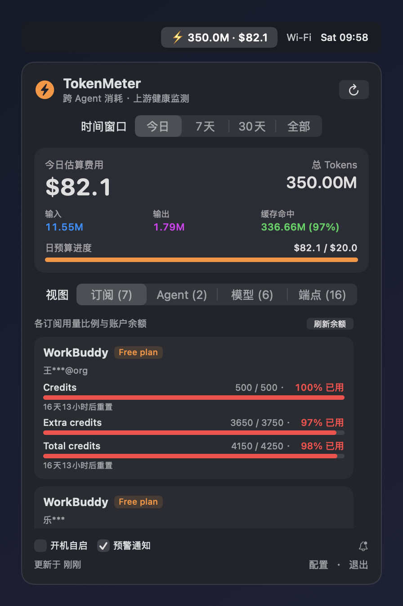
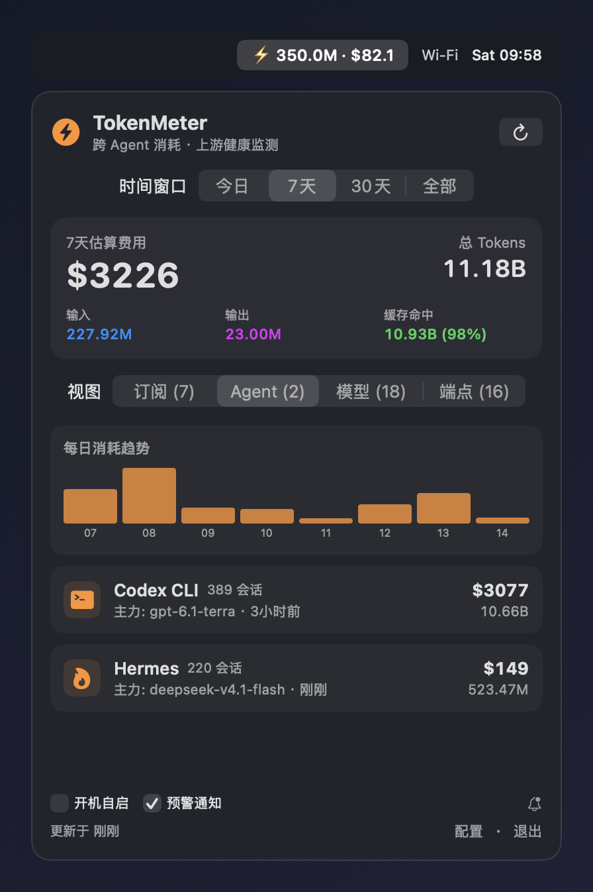
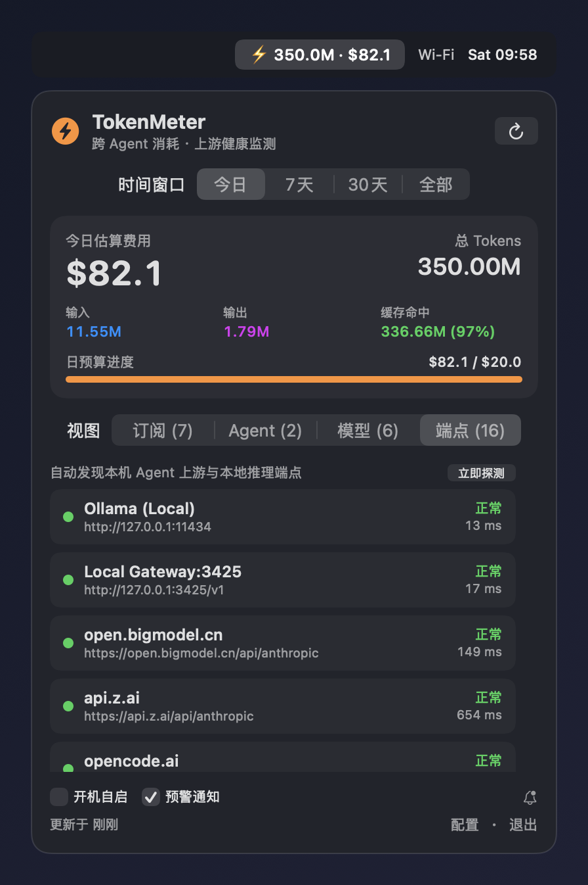
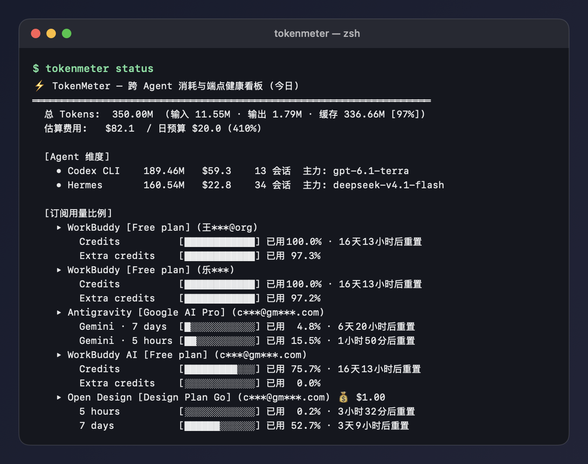

# ⚡ TokenMeter

**原生 macOS 菜单栏 AI Coding 消耗仪表盘 + 终端 CLI**（KeepLid 姊妹项目）。

零侵入、纯本地、无需额外依赖——自动聚合本机所有 AI Coding Agent 的真实 Token 消耗、缓存命中率、估算费用，并实时探测上游中转站 / 本地推理端点的可用性、延迟与 429 限流状态。

---

## 📸 界面与使用效果

<table>
  <tr>
    <td align="center" width="33%">
      <strong>多订阅用量比例与重置倒计时</strong><br/><br/>
      
    </td>
    <td align="center" width="33%">
      <strong>7 天消耗趋势与 Agent 明细</strong><br/><br/>
      
    </td>
    <td align="center" width="33%">
      <strong>上游网关与本地端点延迟探针</strong><br/><br/>
      
    </td>
  </tr>
</table>

<p align="center">
  <strong>终端 CLI 实时看板（<code>tokenmeter status</code>）</strong><br/><br/>
  
</p>

---

## ✨ 核心特性

1. **跨 Agent 本地账本（100% 离线只读解析，零隐私上传）**
   - **Hermes Agent**（`~/.hermes/state.db` 与多 Profile `~/.hermes/profiles/*/state.db`）
   - **Codex CLI**（`~/.codex/sessions/**/*.jsonl` 与 `archived_sessions`，自动去重累计快照）
   - **Claude Code**（`~/.claude/projects/**/*.jsonl`，按 `message.id` 流式去重）
   - **Pi Agent**（`~/.pi/**/*.jsonl`）
   - **OpenCode**（`~/.local/share/opencode/opencode.db`）
2. **多订阅用量比例 & 账户余额自动查询**
   - 自动发现本地网关订阅窗口（Codex、Antigravity / Google AI Pro、Open Design、WorkBuddy 等），精确展示 `5h / 7d / Credits` **已用比例、剩余比例、具体额度（如 `79k / 150k credits`）、美元余额与重置倒计时**
   - 原生直连查询多厂商 API 余额：**OneAPI / NewAPI**、**DeepSeek**、**OpenRouter**、**Moonshot (Kimi)**、**SiliconFlow (硅基流动)**，以及 Codex 原生会话 `rate_limits`
3. **上游网关 & 本地模型健康探针**
   - 自动发现本机配置的网关与本地端点（OneAPI、NewAPI、本地代理端口、MTPLX、Ollama 等，**绝不读取或暴露 API Key**）
   - 实时监测 HTTP 状态、响应延迟（ms）、模型数量与 **429 限流告警**
4. **双形态原生体验 + 系统级守护**
   - **SwiftUI 菜单栏常驻 App (`TokenMeter.app`)**：状态栏实时显示 `⚡ 2.4M · $1.82`，左键弹出订阅/Agent/模型/端点四维看板；支持 **`SMAppService` 一键开机自启**
   - **智能系统通知 (`UNUserNotificationCenter`)**：当订阅窗口跨过预警阈值（默认 `85%`）或耗尽（`98%`）、冷却重置恢复（`<=15%`）、日预算超限或上游触发 `429` 限流时自动推送 macOS 原生通知（内置冷却去重不刷屏）
   - **终端 CLI (`tokenmeter`)**：支持 `--json` 输出，方便接入脚本或其他 Agent 调用

---

## 🚀 安装与部署

### 方式一：源码一键编译安装（推荐）

```bash
git clone https://github.com/Profeel/tokenmeter.git ~/tokenmeter
cd ~/tokenmeter
./scripts/install.sh
```

### 方式二：下载 Release 预编译包

前往 [Releases](https://github.com/Profeel/tokenmeter/releases) 下载 `TokenMeter-v1.0.0-macos-arm64.zip`，解压后将 `TokenMeter.app` 拖入 `/Applications/`，`tokenmeter` 放入 `~/.local/bin/`。

安装完成后：
- **菜单栏应用**：`open /Applications/TokenMeter.app`（或在 Spotlight 搜索 `TokenMeter`）
- **命令行工具**：
  ```bash
  tokenmeter status          # 今日消耗 + 订阅用量比例 + 端点探针
  tokenmeter quotas          # 单独查看各订阅用量比例、重置倒计时与账户余额
  tokenmeter week            # 最近 7 天消耗与模型排行
  tokenmeter models 30d      # 最近 30 天 Top 模型明细
  tokenmeter probe           # 探测所有自动发现端点的延迟与 429 状态
  tokenmeter status --json   # JSON 输出供脚本或 Agent 消费
  tokenmeter watch           # 终端实时刷新监控看板
  tokenmeter init-config     # 生成 ~/.tokenmeter/config.json
  ```

---

## ⚙️ 可选配置 (`~/.tokenmeter/config.json`)

```json
{
  "dailyBudgetUSD": 20.0,
  "budgetAlertRatio": 0.8,
  "gatewayQuotaURLs": [
    "http://127.0.0.1:3425/v1/magpie/quotas"
  ],
  "balanceAccounts": [
    {
      "vendor": "deepseek",
      "name": "DeepSeek",
      "apiKey": "sk-your-deepseek-key"
    },
    {
      "vendor": "openrouter",
      "name": "OpenRouter",
      "apiKey": "sk-or-v1-..."
    },
    {
      "vendor": "oneapi",
      "name": "OneAPI 主站",
      "baseURL": "https://ai.example.com",
      "apiKey": "your-read-only-system-token",
      "userId": 1
    }
  ]
}
```
